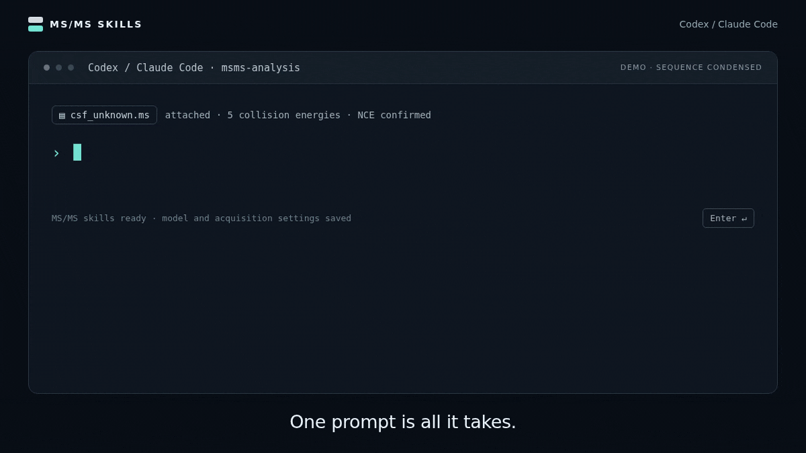

[](https://coley.mit.edu/msms-structure-elucidation.skills/demo/msms-structure-elucidation/)

# MS/MS structure elucidation

Ask Codex or Claude Code to analyze an experimental tandem mass spectrum and explore possible molecular structures. These skills connect your agent to candidate searches, MS/MS prediction with ICEBERG or GLACIER, and an interactive report with spectra and molecular fragments.

[Explore the interactive demo](https://coley.mit.edu/msms-structure-elucidation.skills/demo/msms-structure-elucidation/)

## Quick start

### 1. Install Codex or Claude Code

Choose one and follow its official installation guide: [Codex](https://learn.chatgpt.com/docs/quickstart) or [Claude Code](https://code.claude.com/docs/en/quickstart). Install it on your computer and sign in.

Depending on your account and usage, you may need a paid monthly plan or usage credits. See [Codex plans](https://learn.chatgpt.com/docs/pricing) or [Claude Code access options](https://code.claude.com/docs/en/quickstart#before-you-begin).

### 2. Ask it to install these skills

Create or choose a folder for your analyses. Open Codex or Claude Code in that folder, start a chat, and copy and paste this one-line prompt:

```text
Install and set up https://github.com/coleygroup/msms-structure-elucidation.skills for this project. Read its AGENTS.md and follow its msms-setup skill. Check what is already available, guide me through anything missing, and tell me when setup is ready. I am not providing a spectrum yet.
```

Answer the setup questions, including where analyses should run and which available model to use. The agent checks the required software and model files and helps you complete the setup. You do not need to provide your own spectrum yet.

### 3. Start a new session and run the example

Once setup is complete, start a new chat/session in the same project so the installed skills and tools are available. Copy and paste:

```text
Use msms-structure-elucidation-skills to reproduce the public clinical demo using csf_unknown.ms, plasma_unknown_198.ms, and plasma_unknown_583.ms from ms-pred's data/exp_specs/clinical directory. The provider confirmed 10, 20, 30, 40, and 50 NCE for all three. Use BUDDY’s top three formula hypotheses, search the public ICEBERG 2.1 PubChem atlas first, review the evidence for every result, and show me one interactive report with all three unknowns.
```

These example files are supplied with [ms-pred](https://github.com/coleygroup/ms-pred/tree/main/data/exp_specs/clinical), so you do not need to prepare or upload your own data. Open the report link the agent provides and compare it with the [public demo](https://coley.mit.edu/msms-structure-elucidation.skills/demo/msms-structure-elucidation/). The [demo guide](demo/README.md) records the input spectra, energy settings and saved results.

For your own data, ask:

> Use msms-structure-elucidation-skills to elucidate molecular structures from [file path or GNPS/MassIVE link] and show all results in one interactive report.

Replace the brackets with your file path or URL. For a dataset containing multiple files, specify which files or features to analyze.

## Explore your results

The report shows ranked molecular structures beside an experimental-versus-predicted mirror spectrum. Select a candidate, then click or hover over a peak to see its predicted fragment highlighted on the molecule. Switch collision energies or compare another candidate to examine the evidence.

In the local viewer, you can save candidate comments and fragment notes, then ask:

> Please review my saved notes and refine the candidates.

The public demo lets you try the same review controls; its trial notes stay in your browser. Similarity scores and explained intensity support structural hypotheses. They are not probabilities of identification, and a good match does not establish a unique molecular identity.

## What to provide

| Input | What the agent needs |
| --- | --- |
| Spectrum | A `.ms` file, GNPS2 Everything Bagel/MZmine `.mgf`, raw/mzML data, or a public link to spectra or files in GNPS, GNPS2, MassIVE or another repository. For dataset or task links, specify which files or features to analyze. |
| Collision energies | Values, whether they are NCE or absolute eV, and whether acquisition used separate or stepped energies. For raw/mzML files, the agent checks acquisition metadata first and asks about unresolved settings. |
| Precursor information | Precursor m/z and adduct, when they are not already in the file. |
| Helpful context | Instrument, sample context, and a molecular formula or formula list if you have one. |

A molecular formula is optional. If you do not supply one, the agent recommends BUDDY’s top three formulas and asks whether you want to use those or a [PubChem mass search within a ppm tolerance](docs/technical-guide.md#mass-only-pubchem-option) that skips formula prediction and predicts candidates across every matched formula. Your choice is saved for the current analysis. Mass filtering includes C, H, N, O, P, S, F, Cl, Br, I, Si, B and Se by default; you can tell the agent to use a different element filter.

## What the agent does

1. Reads or converts the spectrum, checks available acquisition information, and asks you about missing or ambiguous settings.
2. Uses supplied formulas, inferred hypotheses, or PubChem mass matches within your ppm tolerance. The mass-only route skips formula prediction and ranks candidates across every matched formula.
3. Uses your confirmed model and weights: ICEBERG can reuse suitable public atlas spectra; GLACIER and mass-only searches predict every candidate. It converts confirmed NCE to integer eV for prediction and compares **all** supplied collision energies.
4. Reviews every result, checks matched and unexplained peaks, and flags structures these spectra cannot distinguish. It keeps monitoring running analyses and can review finished results while other jobs continue.
5. If evidence is weak, asks whether you want proposed new structures, FRIGID de novo generation, both, or neither. You can also add candidate structures or review notes for a follow-up analysis.

The public atlas does not contain licensed NIST structures. A good spectral match supports a hypothesis; it does not establish a unique molecular identity.

## What you receive

- An interactive report with ranked structures, a merged mirror spectrum by default, individual energy views, fragment highlighting, candidate comparison, formula hypotheses, and the evidence behind each rank.
- `retrieval.json`, the machine-readable record of formulas, energy conversion, candidate scores, sources, and explicit outcomes such as no atlas coverage or missing model assets.
- A local review page where candidate decisions and fragment notes are saved to `review_notes.json`. A batch of unknowns can be reviewed together in one page.

For manual installation, batch processing, model files and command-line options, see the [technical guide](docs/technical-guide.md). The [workflow completion hooks](docs/workflow-hooks.md) help the agent track unfinished analyses. The detailed agent procedures live in [AGENTS.md](AGENTS.md), the [scientific workflow](.agents/workflows/msms-elucidation.md), and the [skills](.agents/skills).
